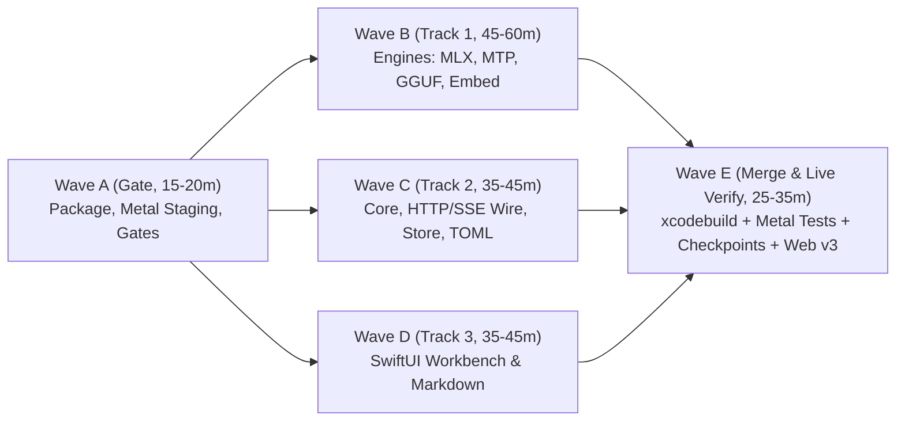

# `heylookitsanllm-macos` — Complete `v2.0.251` Parity Execution Plan (`Waves A–E`)

> Authoritative engineering blueprint for completing full behavioral, engine, `/v1/*` wire, SQLite WAL store, `heylook.toml`, and 6-surface SwiftUI parity with `heylookitsanllm` (`v2.0.251`), starting from `HEAD` (`fd6a3c1`). Designed around **subtraction and upstream leverage**—deleting broken duplicate layers in favor of `mlx-swift-lm` primitives and one shared execution spine so a fresh session can execute Waves A–E cold.

---

## 1. Scope Contract & Settled Owner Decisions

1. **Single-Mac `heylookitsanllm` `v2.0.251` Parity Before Net-New Features (`VISION.md` Tradeoff Rule #3)**:
   Every wire DTO, route, sampler cascade rule, KV/APC rule, GGUF subprocess behavior, multimodal embedding calculation, and 6-surface workbench interaction in `heylookitsanllm` (`v2.0.251`) must match truthfully and pass live hardware verification before net-new macOS/iOS capabilities ship.
2. **Park / Feature-Gate Non-Parity Additions Until Parity Is Verified Live**:
   - **ASR / Parakeet / Voice Dictation**: Gate the always-visible composer mic dictation button (`Sources/HeylookUI/Surfaces/ChatWorkbenchSurface.swift`), CLI `transcribe` advertisement (`Sources/HeylookCLI/HeylookCLI.swift`), and `/v1/audio/transcriptions` + `/v1/conversations/{id}/voice-generate` routes (`Sources/HeylookServer/Routes/AudioAndVoiceRoutes.swift`) behind opt-in `HEYLOOK_ENABLE_EXPERIMENTAL_ASR=1` (off by default).
   - **Retired `Media Finder` / `Media Corpus (mbed)` UI**: `heylookitsanllm` retired `Media Finder` in `v2.0.243`. Gate `Media Corpus (mbed)` mode, permanent left-sidebar corpus indexing controls, permanent 350pt right Artifact Inspector, and duplicate bottom Eval drawer (`Sources/HeylookUI/Surfaces/EmbeddingsStudioSurface.swift`, `Sources/HeylookUI/Controllers/EmbeddingsStudioController.swift`) behind opt-in `HEYLOOK_ENABLE_EXPERIMENTAL_CORPUS=1` so `⌘4` Embeddings defaults cleanly to the three parity tools (**Compare**, **Token Inspector**, **Embedding Lab**).
   - **`CoreAIProvider` Admin Leakage**: Keep `CoreAIProvider` out of `/v1/admin/model-options` (`Sources/HeylookServer/Routes/ModelsAndAdminRoutes.swift`, `Sources/HeylookCore/Config/ProviderConfigSchema.swift`) unless `HEYLOOK_ENABLE_COREAI=1` is set so standard discovery advertises only `mlx` and `gguf`.
   - **Notebook Extra Macros**: Delete non-parity `"Insert Summary"` / `"Analyze Selection"` buttons (`Sources/HeylookUI/Surfaces/NotebookSurface.swift`) that silently overwrite `systemPrompt`.
3. **Settled Owner Decision — Defer Multi-Mac Cluster Sharding to Horizon 2**:
   - Multi-host `mlx.distributed` (`ring`/`jaccl`, `pipeline_peers`, `pipeline_ratios`) and `ggml-rpc` sharding are explicitly deferred to **Post-Parity Horizon 2**.
   - Remove the unimplemented `pipeline_ratios` and `pipeline_peers` schema fields from `Sources/HeylookCore/Config/ProviderConfigSchema.swift` (`L565–582`) and comments in `Sources/HeylookCore/Config/HeylookConfig.swift` (`L30`) in Wave A so schema docs never advertise dead knobs (*Truthful Runtime*).
4. **Settled Owner Decision — No Forks of `mlx-swift-lm` or `mlx-swift` For Now**:
   - Consume canonical upstream `ml-explore/mlx-swift` and `ml-explore/mlx-swift-lm` cleanly via remote SwiftPM dependencies (never `.package(path: ...)` forks).
   - Implement every Wave B MLX fix strictly through upstream `mlx-swift-lm` public/package APIs (`MLXGuidedGeneration`, `MLXEmbedders`, `GenerationComponents`, `PreparedInputSplitting`, `MTPDrafterModelFactory`, `EmbeddingGemma2AudioProcessor`/`ImageProcessor`) and external seams (`APCSnapshotCache`, `LeviathanMTPTokenIterator`, `ThinkingControlLogitProcessor`, `MLXSwiftProvider`).
   - Upstream-invasive optimizations requiring internal changes to `LanguageModel.prepare` (true post-ViT `MLXArray` feature caching across APC misses and custom Metal `uint2`-hoisted Gemma 4 QMV kernels) are deferred to Post-Parity Horizon 2 / upstream PRs.

---

## 2. Holistic Simplification & Subtraction Mandate

> **Delete duplicate layers; unify on upstream `mlx-swift-lm` primitives and one orchestration spine.** Instead of stacking patches over broken bespoke wrappers, Wave A–D intentionally remove ~750+ lines of redundant or misbehaving code:

| Bespoke / Duplicate Layer Being Deleted | Why It Exists / Fails at `fd6a3c1` | Upstream / Unified Replacement (Net Code Reduction) | Wave |
| :--- | :--- | :--- | :---: |
| `VisionFeatureCache` + `CachedVisionImage` (`MLXRuntimeSupport.swift:69–152`) & `resizeCIImageIfNeeded` (`28px` fallback in `MLXSwiftProvider.swift:897–904`) | Caches lazy `CIImage` recipes instead of ViT features; double-resizes images with wrong `28px` grid guess (~100 LOC) | Replace with an 8-line `(SHA-256, imageMaxTokens)` `mediaSalt` helper so multi-branch APC avoids re-running ViT, let `UserInputProcessor` resize once, and encode text-only turns directly via `tokenizer.encode` | **B.5** |
| `HeylookStagedRotatingKVCache` (`MLXRuntimeSupport.swift:504–550`) | Grows rotating ring past `maxSize` (`maxSize + 3`) vs `maxSize` attention mask, crashing Gemma 4 SWA at `512`/`1024` (~50 LOC) | Delete custom wrapper; clone `RotatingKVCache.copy()` for speculation verify and replay retained prefix or adopt verified clone on accept | **B.2** |
| Custom `response_format` stub & missing spec gates | Validates JSON schema then emits unconstrained prose (`MLXSwiftProvider.swift:363–382`) | Link upstream `MLXGuidedGeneration` (`XGrammarBridge` via `GenerationComponents.appendingLogitProcessor`) already in `mlx-swift-lm` | **A.1, B.4** |
| Bespoke `EmbeddingGemma2`-only loader assumption | Hardcoded to `MLXVLM.EmbeddingGemma2Embedding`; fails on other MLX embedding checkpoints | Link upstream `MLXEmbedders` (`EmbedderModelContainer` / `ModelFactory`) alongside `EmbeddingGemma2` | **A.1, B.8** |
| Custom processor wiring missing from speculative iterators | `MTPSpeculativeTokenIterator` & `SpeculativeTokenIterator` omit `thinkingProc`; penalties contaminate prompt tokens | Thread one unified `GenerationComponents` factory (`ThinkingControlLogitProcessor` + `generated_only` penalty processor + `MLXGuidedGeneration` + `logit_bias`) across all iterators | **B.4** |
| Hand-rolled `ANECoreMLRuntime.computeAudioLogMel` (`0.97` pre-emphasis / squared power / no pad) & `prepareImagePixels` stretch (`ModelComputeOptions.swift:549–708`) | ~200 LOC of broken DSP and aspect-destroying `CGContext` draws | Delete bespoke math/resize code; delegate directly to upstream `MLXVLM.EmbeddingGemma2AudioProcessor` & `EmbeddingGemma2ImageProcessor`, and inspect `MLModel.modelDescription` for valid `TextANE` input shapes instead of hardcoding 5 failing buckets | **B.8** |
| Cold model loading inside `planImages` & duplicate GGUF lookups | Loads multi-GB checkpoints on `/image-plan`, hardcodes `thinHeadroomGB = 16.0`, duplicates `resolveLlamaServerBinary`, re-parses `llama-server` output via `ReasoningParser` | Enforce resident-only `409`, share `RAMFitCalculator.thinHeadroomGB` (`24.0`) + `SubprocessSupport` binary finder, and trust `llama-server` split channels | **B.5, B.7** |
| Shadow UI execution & fake startup DB seeding (`NotebookAndPresetsController:707–757`, `EmbeddingsStudioController:691–774, 2262`) | ~230 LOC bypassing `WorkbenchService`, breaking MLX `stop_sequences`, thrashing `llama-server` subprocesses, and seeding fake `doc-*.swift` rows into user `VectorStore` | Delete shadow paths and `seedSampleCorpusIfNeeded`; route all Notebook & Embeddings execution through `WorkbenchBackend` (`WorkbenchService`) | **D.5, D.6** |
| Ad-hoc TOML string serializers (`HeylookConfig.toTOML`, `removeExplicitModelBlock`, `applyQuickContextSize` catch) | ~150 LOC wiping `#` comments, `[settings]`, `[models.config]` sub-tables, and read-only mode | Delete ad-hoc writers; route all config mutations exclusively through comment-preserving `TOMLCodec` | **C.7, D.7** |

---

## 3. Execution Wave Topology & Conflict-Free Worktree Plan

Execute in **3 stages** using isolated shared worktrees for parallel Waves B, C, and D (~1.5–2.0h wall-clock parallel; ~2.5–3.5h sequential):

### Target Ownership Matrix (Zero File Overlap Across Parallel Waves B, C, D)

| Wave | Exclusive Directories / Files Owned | Test Suites Owned | Must Wait On |
| :--- | :--- | :--- | :--- |
| **Wave A** | `Package.swift`, `scripts/build_native.sh`, `Sources/HeylookCore/Config/FeatureFlags.swift` *(new)*, `Sources/HeylookCore/Config/RuntimeConfigurationApplying.swift` *(new protocol)*, `Sources/HeylookCLI/HeylookCLI.swift`, `Sources/HeylookCore/Config/ProviderConfigSchema.swift` (drop `pipeline_*`), gate wiring in `AudioAndVoiceRoutes.swift`, `ModelsAndAdminRoutes.swift`, `ChatWorkbenchSurface.swift`, `EmbeddingsStudioSurface.swift`, `NotebookSurface.swift` | Existing 28 tests (`swift test`) | — |
| **Wave B** | `Sources/HeylookEngines/**`, `Sources/HeylookEmbeddings/**` (including `ComputeScheduler` conformance to `RuntimeConfigurationApplying` and Metal/idle hooks) | `Tests/HeylookTests/EmbeddingsAndSpecializationTests.swift` + new `MLXEngineParityTests.swift` | Wave A |
| **Wave C** | `Sources/HeylookCore/**` *(excl. `FeatureFlags.swift` & `RuntimeConfigurationApplying.swift`)*, `Sources/HeylookServer/**` *(delegating GPU cache limit / idle settings via `ComputeScheduler`)* | `Tests/HeylookTests/EngineContractTests.swift`, `SamplerAndTemplateTests.swift`, `MessagesAndSagaContractTests.swift` | Wave A |
| **Wave D** | `Sources/HeylookUI/**`, `Sources/HeylookApp/**` | `Tests/HeylookTests/WorkbenchControllersTests.swift` | Wave A |
| **Wave E** | Integration merge, `scripts/build_native.sh` verification, `docs/project/CURRENT.md`, `docs/project/TODO.md`, `docs/wiki/*.md` post-run sync | Full `xcodebuild test` (`HeylookTests` w/ MLX + Metal) + live checkpoints + Web v3 browser check | Waves B, C, D |

---

## 4. Wave A — Native MLX/Metal Build, Package Seam & Scope Gates (`15–20m`)

### A.1 Package Defaults, Upstream Products & Pins (`Package.swift`)
- **Problem**:
  - `Package.swift:9–14` evaluates `enableNativeMLX = false` outside Xcode IDE unless `HEYLOOK_ENABLE_NATIVE_MLX=1` is exported, compiling out `MLX` / `MLXLMCommon` / `MLXVLM` / `Transformers` on standard `swift build` / `swift test` / `swift run heylook-cli`.
  - `Package.swift:30–31` uses floating `branch: "main"` on `mlx-swift-lm`.
  - Upstream `MLXGuidedGeneration` and `MLXEmbedders` libraries already inside `mlx-swift-lm` are not linked into `HeylookEngines` / `HeylookEmbeddings`.
- **Fix**:
  1. Default `enableNativeMLX` to `true` unless `HEYLOOK_DISABLE_NATIVE_MLX == "1"` or `HEYLOOK_ENABLE_NATIVE_MLX == "0"` is set (retaining opt-out for Metal-free sandboxed offline contract checks).
  2. Link `.product(name: "MLXGuidedGeneration", package: "mlx-swift-lm")` into `HeylookEngines` and `.product(name: "MLXEmbedders", package: "mlx-swift-lm")` into `HeylookEmbeddings`.
  3. Pin `mlx-swift-lm` to an exact verified commit `revision:` in `Package.swift`, and keep `enableCoreAI = enableAll || env["HEYLOOK_ENABLE_COREAI"] == "1"`.

### A.2 Portable CLI Metal Staging & Native Metal Test Runner (`scripts/build_native.sh`)
- **Problem**:
  - `mlx-swift/Package.swift:319` excludes `mlx/mlx/backend/metal/kernels` from SwiftPM C++ builds, so `HEYLOOK_ENABLE_NATIVE_MLX=1 swift run` aborts at runtime with `Failed to load the default metallib.`.
  - `scripts/build_native.sh:127–131` stages `mlx-swift_Cmlx.bundle` inside `HeylookWorkbench.app`, **but executes `heylook-cli` directly inside `DerivedData`** (`L174`), leaving CLI distribution non-portable.
- **Fix**:
  1. Add `assemble_cli_bundle()` in `scripts/build_native.sh` staging `.build/native/bin/heylook-cli` alongside `mlx-swift_Cmlx.bundle` (`default.metallib` + resource symlinks) so CLI runs cleanly outside `DerivedData`.
  2. Ensure `./scripts/build_native.sh test` runs `HeylookTests` via `xcodebuild test` with compiled Metal shaders so `#if canImport(MLX)` tests actually execute.
  3. Add an explicit preflight check for colocated `mlx.metallib` / `mlx-swift_Cmlx.bundle` before initializing MLX so un-built CLI binaries raise a clean actionable diagnostic instead of crashing inside C++ `std::runtime_error`.

### A.3 Truthful `heylook-cli doctor` (`Sources/HeylookCLI/HeylookCLI.swift:79–116`)
- Derive provider availability at compile + runtime via `#if canImport(MLXLMCommon)` / `#if canImport(CoreAILanguageModels)`, report whether `default.metallib` (`mlx-swift_Cmlx.bundle`) was found, check `llama-server` binary discovery (`PATH` or user `.heylook/llama.cpp/build/bin/llama-server`), and hide `transcribe` / CoreAI lines unless their parity-deferral flags are enabled.

### A.4 Post-Parity Feature Gates & Clean Protocol Seam (`FeatureFlags.swift`)
- Create `Sources/HeylookCore/Config/FeatureFlags.swift`:
  - `experimentalASR`: `HEYLOOK_ENABLE_EXPERIMENTAL_ASR == "1"` (default `false`). Gates composer mic button (`ChatWorkbenchSurface.swift:1694`), audio routes (`AudioAndVoiceRoutes.swift`), and CLI `transcribe` advertisement.
  - `experimentalCorpus`: `HEYLOOK_ENABLE_EXPERIMENTAL_CORPUS == "1"` (default `false`). Gates `Media Corpus (mbed)` tab, corpus sidebar controls, permanent 350pt right Artifact Inspector, and duplicate bottom Eval drawer (`EmbeddingsStudioSurface.swift`, `EmbeddingsStudioController.swift`).
  - `coreAI`: `HEYLOOK_ENABLE_COREAI == "1"` (default `false`). Excludes `coreai` from `/v1/admin/model-options` and `ProviderConfigSchema` public listings by default.
- Create `Sources/HeylookCore/Config/RuntimeConfigurationApplying.swift` (narrow protocol so Wave C's `WorkbenchService` delegates `[settings]` GPU cache limit & idle-unload seconds cleanly to Wave B's `ComputeScheduler` without cross-wave file edits).
- Delete `pipeline_ratios` and `pipeline_peers` from `ProviderConfigSchema.swift:565–582` and remove `"Insert Summary"` / `"Analyze Selection"` macro buttons from `NotebookSurface.swift`.

---

## 5. Wave B — Engines: MLX, MTP, GGUF & Embeddings (`45–60m`)

### B.1 Multi-Turn MLX APC Slicing, `PreparedInputSplitting`, Capture Boundaries & `LMOutput.State`
- **Files**: `Sources/HeylookEngines/Providers/MLXSwiftProvider.swift` (`L926, 976–1054, 1076–1096`), `Sources/HeylookEngines/Providers/MLXRuntimeSupport.swift` (`L156–279`).
- **Verified Bugs**:
  1. **Axis-0 Tensor Slice Crash on Turn 2 (`MLXSwiftProvider.swift:978`)**: `lmInput.text.tokens` is 2D `[1, seqLen]`, and Turn 2 executes `LMInput(text: lmInput.text[apcMatch.reusedPrefixTokens...])`. `LMInput.Text.subscript` slices axis `0` (batch `1` at `15...` -> empty `[0, seqLen]` tensor!) instead of sequence axis `1`.
  2. **Missing `LMOutput.State` (`qwen35.ropeDeltas`) & 0% Hit Rate When Thinking Is On**: Iterators ignore or miss `apcMatch.state` (`ContinuationStateError.missingState` on `Qwen3.5` / `Qwen3.8` / `Qwen3-VL` / `Qwen2.5-VL`), and Turn-end-only snapshotting misses every Turn 2 when historical `<think>` blocks are stripped and `MambaCache` / saturated `RotatingKVCache` has `isTrimmable == false`.
  3. **Dropped `lmInput.image` & Unprotected VLM Media Spans**: Slicing text directly drops `lmInput.image` when reused prefixes precede media tokens or split bidirectional media spans (`_apc_media_token_ids`).
- **Fix Design**:
  1. Prefer upstream `PreparedInputSplitting` (`splitPreparedInput(_:droppingFirst:)`) when the model conforms; otherwise verify zero media tokens lie at or after `common` and slice axis `1` (`tokens[0..., common...]`, `mask.map { $0[0..., common...] }`). Whenever uncached media lies in the suffix on non-splitting models, cleanly cold-prefill (`reusedTokens = 0`, `effInput = lmInput`, `missCause = "media_uncached"`).
  2. Protect media spans (`<|image_pad|>`, `<|vision_start|>`, `<|vision_end|>`, `<|image|>`, `<start_of_image>`, `<image_soft_token>`, `<end_of_image>`, `<|audio|>`) so `common` never splits mid-span.
  3. Capture APC snapshots at system-prompt prefix end AND prefill end in addition to turn end (`install_capture_policy` parity), retaining `iterator.state` (`LMOutput.State`) on every saved `APCSnapshotCache.Entry` and passing `apcMatch.state` into every iterator.

### B.2 `LeviathanMTPTokenIterator` Repair (`Gemma 4` + `Qwen3.5` MTP)
- **File**: `Sources/HeylookEngines/Providers/MLXRuntimeSupport.swift` (`L504–550, 562–1188`).
- **Verified Bugs at `fd6a3c1`**:
  1. `HeylookStagedRotatingKVCache` (`L504–550`) grows ring keys to `maxSize + 3` while delegating `makeMask(n: 4, windowSize: maxSize)` to `live`, crashing Gemma 4 SDPA once context hits `sliding_window` (`512` / `1024`).
  2. `LeviathanMTPTokenIterator` never normalizes `pVec` vs `CapturingDraftSampler.capturedProbs` (`qVec`): 3D `[1, 1, vocab]` draft logits crash `qVec[0..., draftId]` (`L1004`) and turn `corrTok` into 2D `[1, 1]`.
  3. Hybrid SSM/Mamba (`Qwen3.5` + `qwen3_5_mtp`, `v2.0.250`) never sets `verifyState[mtpCacheCheckpointIndexKey] = 1` or rewinds recurrent state (`MTPSpeculativeTokenIterator.swift:543–632`), calling no-op `cache.trim(...)` (`L1048`) and corrupting `MambaCache` on rejected drafts.
  4. Never wraps model calls in `withPreparedCache` (`Evaluate.swift:1139`).
- **Fix Design**:
  1. Delete `HeylookStagedRotatingKVCache` completely. Before verifying `[y.tokens, flatDraft]`, snapshot rotating caches via `rot.copy()` for the verify pass; adopt verified clones on `rejected == 0` or replay **only** `verifyTokens[0..<retained]` onto pre-verify `live` on `rejected > 0`.
  2. Squeeze/reshape `pVec` and `qVec` (`CapturingDraftSampler.capturedProbs`) to `[1, vocab]` before indexing `[0..., draftId]` and computing residuals (`corrTok` always 1D).
  3. Set `verifyState[mtpCacheCheckpointIndexKey] = 1` when `mainModel` supports `SpeculativeCacheRewindModel` with `MambaCache`, and call `rewindSpeculativePromptCache` instead of raw `.trim(...)`.
  4. Wrap target/drafter forward calls with `withPreparedCache` and reconcile `mtpSharedKVOffsetsKey` cleanly (`queryOffset = L`, then `L + K`).

### B.3 In-Checkpoint `Qwen3.5` MTP Discovery & Masked-Diffusion Dispatch *(Addendum Item #5)*
- **File**: `Sources/HeylookEngines/Providers/MLXSwiftProvider.swift` (`L115, 205–245, 1002–1053`).
- **Fix**:
  1. When `sidecar?.draftModel == nil`, probe the target checkpoint / config for embedded `mtp.*` weights using upstream `MTPDrafterModelFactory` + `Qwen35CheckpointPolicy(layout: .embedded)` (`Qwen35Checkpoint.swift`), enabling in-checkpoint MTP on `Qwen3.5` / `Qwen3.8` without requiring a separate sidecar repo.
  2. Detect masked-diffusion checkpoints (`model_type` in `diffusion|llada|dream`, or `canvas_length` / `mask_token_id` in `config.json`) and dispatch to `NemotronLabsDiffusionModel` block diffusion (or throw explicit `400 invalid_request_error` on unsupported diffusion families instead of falling into causal `TokenIterator`).

### B.4 MLX `response_format` (`MLXGuidedGeneration`), `logit_bias`, `generated_only` Penalties & Speculative Gates
- **Files**: `Sources/HeylookEngines/Providers/MLXSwiftProvider.swift` (`L363–382, 683–703, 988–1053`), `Sources/HeylookEngines/Providers/MLXRuntimeSupport.swift` (`L371–482`).
- **Fix**:
  1. Wire upstream `MLXGuidedGeneration` (`XGrammarBridge`) for `json_object` and `json_schema` `response_format` payloads inside `GenerationComponents.appendingLogitProcessor`.
  2. Disable speculative decoding (`useMTP = false`, `useDraftModel = false`) whenever `response_format != nil` or `logit_bias != nil`, and disable external non-MTP draft models when repetition/presence penalties are active (`v2.0.250`–`v2.0.251`).
  3. Apply `logit_bias` inside the unified `GenerationComponents` processor chain.
  4. Simplify & fix `ThinkingControlLogitProcessor`:
     - Enforce `generated_only` penalties (`prompt(_:)` never seeds prompt tokens into `PenaltyProcessor`), eliminating cold-prefill vs warm-APC drift.
     - Inject the caller's `RequestRegistry` instead of `RequestRegistry.shared`.
     - Preserve incoming logits rank (`[1, vocab]` vs `[1, 1, vocab]`), add `.harmonyChannel` & `.recipientChannel` closers, thread the unified processor through `.standardMTP` & `.speculative`, keep `TokenIterator`'s default `kvCachePlan`, and load `eos_token_id` arrays from `generation_config.json` (`mlx.md:37`).

### B.5 VLM `/image-plan` (`409` Resident Rule + `THW * patchSize`) & Text/VLM Input Cleanup *(Addendum Items #3 & #4)*
- **Files**: `Sources/HeylookEngines/Providers/MLXSwiftProvider.swift` (`L262–298, 895–936`), `Sources/HeylookEngines/Providers/GGUFSubprocessProvider.swift` (`L960–1015`), `Sources/HeylookEngines/Providers/MLXRuntimeSupport.swift` (`L27–152`).
- **Fix**:
  1. **Enforce Resident-Only `409 model_not_loaded` *(Addendum #3)***: Delete `ensureContainerLoaded()` from `MLXSwiftProvider.planImages` (`L264`) and `ensureSubprocessRunning()` from `GGUFSubprocessProvider.planImages` (`L968`); cold models immediately fail with `409 model_not_loaded` (`image_plan.py:16`).
  2. **Multiply `THW` Patch Grid by `patchSize`**: In `MLXSwiftProvider.planImages`, use `buildOverriddenVLMProcessor` (`image_max_tokens`) and read `vision_config.patch_size` (`14` / `16` via checkpoint config / specialization) so `target` emits `[frame.w * patchSize, frame.h * patchSize]` pixels instead of `14x`-shrunk grid counts; pass `"add_generation_prompt": false` in `GGUFSubprocessProvider.queryGGUFInputTokenCount`.
  3. **Delete Fake `VisionFeatureCache` & Fix `PreRenderedVLMTokenizerProxy` *(Addendum #4)***: Delete `CachedVisionImage` / `VisionFeatureCache` and the premature `28px` `CIImage` double-resize (`MLXSwiftProvider.swift:897–904`), keeping only a tiny `(SHA-256, imageMaxTokens)` `mediaSalt` helper for APC while letting upstream `UserInputProcessor` resize images once. Encode text-only turns directly via `context.tokenizer.encode` and make `PreRenderedVLMTokenizerProxy` intercept pre-rendered text cleanly so `UserInputProcessor` implementations never double-template or hoist images when calling `encode(text:)` directly.

### B.6 Runtime Config Wiring, Metal Cache Limit & Idle Unload Reaper
- **Files**: `Sources/HeylookEngines/ComputeScheduler.swift`, `Sources/HeylookEngines/Providers/MLXSwiftProvider.swift`, `Sources/HeylookEngines/Providers/GGUFSubprocessProvider.swift`, `Sources/HeylookEngines/Specialization/ModelSpecialization.swift:297`, `Sources/HeylookCore/Config/HeylookConfig.swift`.
- **Fix**:
  1. Conform `ComputeScheduler` to `RuntimeConfigurationApplying`: apply `MLX.GPU.set(cacheLimit:)` on startup and live `[settings]` updates (`null` resets to default) + Metal wired-memory coordination (`WiredMemoryTicket`).
  2. Parse global `idle_unload_seconds` and per-model `unload_after_idle_seconds`; run an idle unload reaper + `DispatchSource.makeMemoryPressureSource` eviction in `ComputeScheduler`.
  3. Wire MLX knobs into `MLXSwiftProvider`: `ctx_size`, `kv_bits`, `kv_group_size`, `quantized_kv_start`, `prefill_step_size`, `draft_block_size`, `draft_max_context` (removing `max_position_embeddings` fallback at `ModelSpecialization.swift:297`), and `chat_template_source`.
  4. Wire GGUF knobs into `GGUFSpawnConfig.autoSized`: `spec_draft_n_max`, `spec_draft_p_min`, `spec_draft_n_min`, `draft_max_context`, `n_cpu_moe`, `cpu_moe`, `override_tensor`, `batch_size`, `ubatch_size`, `cache_ram_mb`, `ctx_checkpoints`, `checkpoint_min_step`, `extra_args`.

### B.7 GGUF Subprocess Hardening, `KNOBS_OFF`, Cache Witness & Live RSS *(Addendum Item #6)*
- **Files**: `Sources/HeylookEngines/Providers/GGUFSubprocessProvider.swift`, `Sources/HeylookEngines/Providers/StreamingPipeline.swift`, `Sources/HeylookEngines/Providers/SubprocessSupport.swift`.
- **Fix *(Addendum #6)***:
  1. Clamp default `--image-max-tokens` to `<= effectiveUbatch` (`nUbatch ?? 512`) so non-causal vision projectors never abort, and replace hardcoded `thinHeadroomGB = 16.0` (`L175`) with `RAMFitCalculator.thinHeadroomGB` (`24.0`).
  2. Gate `--reasoning-preserve` on active template capability (`supportsPreserveReasoning`), omit `chat_template_kwargs["enable_thinking"]` when `thinkingControls.switchVariable == nil` (`gpt-oss`), emit explicit `KNOBS_OFF` (`top_k: 0`, `min_p: 0.0`, `repeat_penalty: 1.0`, `presence_penalty: 0.0`) when unset, and forward per-request `reasoning_budget_tokens` cleanly.
  3. Never re-parse `llama-server` `content` through `ReasoningParser` (`gguf.md:14`), strip whitespace-only echoed `reasoning_content` tail chunks after closed-thought continuation, and fix `StreamingPipeline.swift` (`L662, 703`) to count actual emitted tokens rather than SSE chunks.
  4. Parse `llama-server` `server_prompt_cache` slot logs (`v2.0.249` `llama_cache_witness.py`), discover sibling `<stem>-mtp` drafters (`v2.0.245`) with single-retry auto-drop fallback, unify `llama-server` lookup into `SubprocessSupport`, isolate subprocess groups (`setpgid` + graceful `SIGTERM`), and report live `proc_pidinfo` `pti_resident_size` RSS for `systemMetrics()`.

### B.8 Multimodal & GGUF Embeddings Repair *(Addendum Items #1 & #2)*
- **Files**: `Sources/HeylookEmbeddings/Engine/GGUFEmbeddingEngine.swift`, `Sources/HeylookEmbeddings/Engine/ModelComputeOptions.swift`, `Sources/HeylookEmbeddings/Engine/NativeMLXEmbeddingGemma2.swift`, `Sources/HeylookEmbeddings/Store/VectorStore.swift`.
- **Fix *(Addendum #1 & #2)***:
  1. **Delete Hand-Rolled Audio DSP & Stretched Image Code *(Addendum #1)***: Remove ~200 LOC of broken `ANECoreMLRuntime.computeAudioLogMel` (`0.97` pre-emphasis, squared power, missing 200-sample semicausal padding) and `prepareImagePixels` rectangle-stretching in `ModelComputeOptions.swift`; reuse upstream `MLXVLM.EmbeddingGemma2AudioProcessor` (`preemphasis == 0.0`, STFT magnitude `|X|`, semicausal pad, `log(mel + 1e-5)`) and aspect-preserving `48px` grid preprocessing (`EmbeddingGemma2ImageProcessor`), and inspect compiled `TextANE.mlmodelc` `MLModelDescription` input constraints dynamically rather than hardcoding failing `[64, 320, 512, 768, 1024]` buckets against `(1, 512, 513)` exports.
  2. **Batched GGUF `/embeddings`, Non-Blocking `stderr`, Lifecycle & Arbitrary Dims *(Addendum #2)***: Drain `GGUFEmbeddingEngine` `stderrPipe` via `readabilityHandler`, register in `SubprocessLifecycleRegistry` (stopping on `unloadModel` & LRU eviction), send one batched POST to `llama-server` `/embeddings` (`{"content": texts}`), and support checkpoint-derived `nativeDimensions` (`384d`–`4096d`) across `GGUFEmbeddingEngine` & `VectorStore.swift:42–60`.
  3. **Support General MLX Embedders (`MLXEmbedders`) & Pool Before Matryoshka *(Addendum #2)***: Add `MLXEmbedders` fallback loader for non-`EmbeddingGemma2` MLX embedding checkpoints; chunk pure-GPU MLX text batches by length; pool full `768d` video window embeddings *before* Matryoshka truncation + L2 norm (`NativeMLXEmbeddingGemma2.swift:1395–1412`); and preserve single-window video `(startSeconds, endSeconds)` in `VectorStore.swift:761`.

---

## 6. Wave C — Core Wire Contract, SQLite Store & `heylook.toml` (`35–45m`)

### C.1 Missing HTTP Routes
- `DELETE /v1/conversations/{id}/generate` (`ConversationsRoutes.swift`): Cancel active generation task via `RequestRegistry` (`200 {"stopped": true|false, ...}`) so web v3 **Stop** stops getting `405`.
- `POST /v1/conversations/{id}/generate/reasoning-end` (`ConversationsRoutes.swift`): Signal early thinking end on the active conversation turn (`200`) instead of `404`.
- `GET /openapi.json` (`SystemAndPerfRoutes.swift`): Generate and serve machine-readable OpenAPI JSON covering active `/v1/*` routes.

### C.2 Canonical Wire Field Names (`EngineDescription`, `SamplerCascade`, `ProviderConfigSchema`)
- `CacheReport` (`EngineDescription.swift:94–127`): Encode snake_case `{prompt_tokens, cached_tokens, processed_tokens, outcome, cause, reason}`.
- `SpeculativeReport` (`EngineDescription.swift:222–229`): Encode `{drafted, accepted, emitted, acceptance_rate, draft_share}`.
- `SamplerCascade` & `ProviderConfigSchema`: Emit canonical `reasoning_effort` & `thinking_budget_tokens` everywhere on the wire while decoding legacy `thinking_depth` / `thinking_budget` gracefully from local files.
- Thread `repetition_context_size` into `MessagesRequest` in `WorkbenchService.swift:897–910` and `ConversationOrchestrator.swift:452–471`.

### C.3 `POST /v1/conversations/{id}/prompt` Parity
- Match request `edits` (`[{message_id?, content?: str | blocks, thinking?: str | null}]`) without wiping `contentBlocks`; return `{prompt, model_id, provider, mode, continuation, dropped_media, unrendered_media: {images, audio}, char_count, markers}`; set `continuation: true` on `user` anchors in `continue` mode; pass GGUF `reasoning_content` + media `parts` to `llama-server /apply-template` without silent CPU fallback on unloaded models.

### C.4 `EngineContract` & Admin Endpoints Parity
- `EngineContract.swift`: Emit `engine.embedding.limits` `{items: 16, blocks_per_item: 32, text_chars: 131072, media_bytes: {image, audio, video}, request_media_bytes}`, `engine.runtime.value = "mlx-vlm"`, `null` `engine.thinking` when template-less, 7-key `engine.cache`, `null` `engine.decoding.request_fields` on non-diffusion models, and GGUF `flash_attn.auto = "on"`.
- `/v1/admin/models/{id}/chat-template`: `"heylook_override"` source enum, `override_path`, `notes`, canonical `sources[]`, and `_PROBE_SHAPES` validation.
- `/v1/admin/models/{id}/fit`: `422` on missing/empty weight paths, `JSONValue` `config_overrides`, explicit `null` serialization.
- `/v1/admin/models/{id}/reload`: `400` on MLX `ctx_size` edits; return `{status: "loaded", model_id, memory_mb, warmed}`.
- `PUT /v1/admin/config`: Support `"memory_only"` persistence when `HEYLOOK_READONLY_MODEL_CONFIG=1` and handle `{"mlx_cache_limit_gb": null}` via `ComputeScheduler` (`RuntimeConfigurationApplying`).
- `GET /v1/performance/profile/{range}` (`SQLiteStore.swift:2132–2288`): Include `resource_timeline` buckets and record stateless `/v1/messages` timings.

### C.5 Messages, SSE, Saga & Explicit `null` Serialization
- Echo `X-Request-ID` header on `POST /v1/messages` and `POST /v1/embeddings`; register `requestID` before model preload.
- Apply `StripSpecials` on `/v1/messages`; detect open-thought prefill `startsInThinking`; enforce `422` on retired wire fields (`enable_thinking`, `max_new_tokens`, `logprobs`, `preset`); stop inventing wall-clock `generation_tps` when absent (`TelemetryBuilder.swift:29`).
- Set SSE `stop_reason: "max_tokens"` on aborted streams (`SSEStreamWriter.swift:419`) and `heylook_saved.end_reason` strictly to `"complete" | "aborted" | "error"` (`ConversationOrchestrator.swift:646–650`).
- Acquire `tryAcquireConversationLock` *before* `getConversationDetail` (`ConversationOrchestrator.swift:311–474`); start empty conversations at position `0`; serialize explicit `null` keys on wire DTOs; add SSRF scheme/host validation on `WorkbenchService.embed` remote image/audio URIs (`L1240`).

### C.6 `SQLiteStore` Fixes (`SQLiteStore.swift:1050, 1290–1340`)
- Clear `content_blocks_json` (`NULL`) explicitly when message edits remove all images (`COALESCE` bypass on explicit clear), and preserve `message_stats` inside `cloneConversationWithMessages`.

### C.7 Single-Source `TOMLCodec` Config & Multi-GGUF Isolation (`HeylookConfig.swift`, `TOMLCodec.swift`)
- Unify `loadDefault()` & `activeConfigURL()`, delete ad-hoc TOML writers/splicers so 100% of saves and removals (including nested `[models.config]`) route through comment-preserving `TOMLCodec`, honor `[scan] scan_interval_seconds = 0`, and support per-file `<stem>.heylook.toml` / `<stem>.chat_template.heylook.jinja` + exact `.gguf` weight path resolution in multi-GGUF directories (`L2676`).

### C.8 Static Web v3 Frontend Hosting & IPv6 Transport
- Auto-discover `HEYLOOK_FRONTEND_DIR` (or configured frontend folder) and serve `/`, `icon.svg`, `apple-touch-icon.png`, `/favicon.ico` (`-> icon.svg`), and `/js/*`, `/css/*` with `Cache-Control: no-cache` (`StaticFrontendRoutes.swift`), emit `HEAD` `Content-Length` (`HTTPConnectionHandler.swift:464`), and permit IPv6 `[::1]` `Host` headers (`HeylookHTTPServer.swift:127`).

---

## 7. Wave D — SwiftUI 6-Surface Workbench Parity (`35–45m`)

### D.1 Chat Editor, Attachments & `"Fit W×H"`
- Persist cleared message images (`[]`) cleanly and transmit `"thinking": null` on `RemoteWorkbenchBackend` (`L770`).
- Hide `Save & Regenerate` on `assistant` turns (`ChatWorkbenchSurface.swift:1387`).
- Fix `Preview prompt` (`ChatController.swift:2454–2492`): honor role/anchor mode (`regenerate` vs `continue`), include `editingThinking` & `editingAttachments`, keep `[text, image]` block order, and fix `>2048px` `"Fit W×H"` vs `"Full res"` priority (`ChatController.swift:51–60`).

### D.2 Chat Stream Recovery, `503` Retry & Live Stop/End-Thinking
- Preserve `heylook_saved` partial turns if a subsequent stream `event: error` fires (`RemoteWorkbenchBackend.swift:531`); add `503 Retry-After` (`MAX_BUSY_RETRIES = 3`); display live **Stop** / **End thinking** controls whenever switching to a `generating == true` conversation; enforce `refuseWhileUnsaved`.

### D.3 Contract Wiring & Inline Load/Reload Bar
- Wire `DocumentSettingsController.activeContractProvider` (`HeylookWorkbenchViewModel.swift:516–555`), keep `chat.activeAdminRow` fresh across surface switches, surface the inline Load/Reload bar directly in Chat for both MLX & GGUF (`ChatWorkbenchSurface.swift:470`), and commit custom `ctx_size` edits on submit/blur instead of per-keystroke clamping.

### D.4 Presets & Sampler Sliders
- Emit `"full"` / `"sampler"` scopes rather than surface titles on Inspector `Save…` (`ChatWorkbenchSurface.swift:2838–2845`, `DocumentSettingsController.swift:513–521`); route `PresetsSurface` **Apply** to the originating surface (`chatSettings` vs `notebookSettings`); constrain `Presence Penalty` to `0.0...2.0`; edit `Stop Sequences` as multi-line / chip entries preserving `\n\n`.

### D.5 Unified Notebook Generation Spine (`NotebookAndPresetsController.swift:707–810`)
- Delete direct `computeScheduler.provider(for:)` shadow generation and route Notebook through `WorkbenchBackend` (`WorkbenchService`), enabling MLX `stop_sequences`, `reasoning_effort` validation, Perf telemetry, live `<think>` status, and remote `Save to Chat` (`L794`).

### D.6 Unified Embeddings Studio, Shared-Pool `Recall@3` & Delete Fake Seeding (`EmbeddingsStudioController.swift`)
- Delete direct engine instantiation (`L2262`) and `seedSampleCorpusIfNeeded` (`L691–774`), routing all embeddings through `backend.embed(...)`.
- Fix `Embedding Lab` **Recall@3** (`L1893–1915`) to rank every query across the **deduplicated union pool of all benchmark items (~20 passages/media)** across cases (`embed-kit.js`), derive readiness truthfully (`isActiveEmbeddingEngineSynthetic` deleted), and retain security-scoped URL access across video previews and eval runs.

### D.7 Models, Perf, Markdown & `⌘,` Settings
- Persist `toggleModelPin` (`ModelsAndPerfController.swift:1062`), route `Remove All Overrides` (`L1265`) through `patchAdminModel`, preserve TOML comments in `applyQuickContextSize`, disable MLX `Load` on `RAMFit` `fail`, add unsaved draft warning to `ModelConfigEditorSheet`, and add `Danger zone -> Clear all conversations & notebooks`.
- Show accurate ANE lane status & live GGUF RSS in `PerfServerSurface.swift`.
- Fix loose numbered/indented list chunking + add `` & bare URL autolinks in `MarkdownMessageView.swift:198`.
- Wire `⌘,` Settings Remote Peer URL and Embedding actions in `HeylookApp.swift:265–350`.

---

## 8. Wave E — End-to-End Build, Metal Tests & Live Acceptance Gate (`25–35m`)

1. **Path Privacy & Subtraction Audit**: `find-external-paths.sh -d .` exits `0`; zero `allowSyntheticFallback`, `DeterministicHashEmbeddingEngine`, `seedSampleCorpusIfNeeded`, `HeylookStagedRotatingKVCache`, `VisionFeatureCache`, `computeAudioLogMel`, or `.package(path:)` references remain.
2. **Dual Build Matrix**: `./scripts/build_native.sh build` (Metal + native MLX + portable `.build/native/bin/heylook-cli doctor` outside `DerivedData`) and `swift build --target HeylookUI --triple arm64-apple-ios27.2-simulator` both exit `0`.
3. **Full Test Suite With MLX + Metal**: `./scripts/build_native.sh test` runs all `HeylookTests` suites (`MLXEngineParityTests` included) with `0` failures.
4. **Live Apple Silicon Checkpoint Matrix**:
   - MLX dense + thinking (`Turn 2` APC reuse, `reasoning-end`, `DELETE .../generate`, `json_schema`, `presence_penalty` invariance).
   - MLX VLM (cold `409` `/image-plan`, pixel `THW * patchSize`, `"Fit W×H"` >2048px, image clear persistence `[]`).
   - Hybrid / Speculative (`Qwen3.5` built-in MTP & `Gemma 4` past `sliding_window` `512`/`1024`).
   - GGUF (`llama-server` vision `--image-max-tokens <= n_ubatch`, `cache_witness`, live `proc_pidinfo` RSS, `/apply-template`, `KNOBS_OFF`).
   - Embeddings (`Embedding Lab` honest `<100%` shared-pool `Recall@3`, batched `/embeddings` + arbitrary dims without `stderr` hang, audio log-mel & video window timestamps).
5. **Live Web v3 Frontend Check**: Launch `./scripts/build_native.sh cli serve 8000` with `HEYLOOK_FRONTEND_DIR` serving web v3 and verify Chat, Notebook, Presets, Embeddings, Models, and Perf with zero `404`/`405`/`422` console errors.
