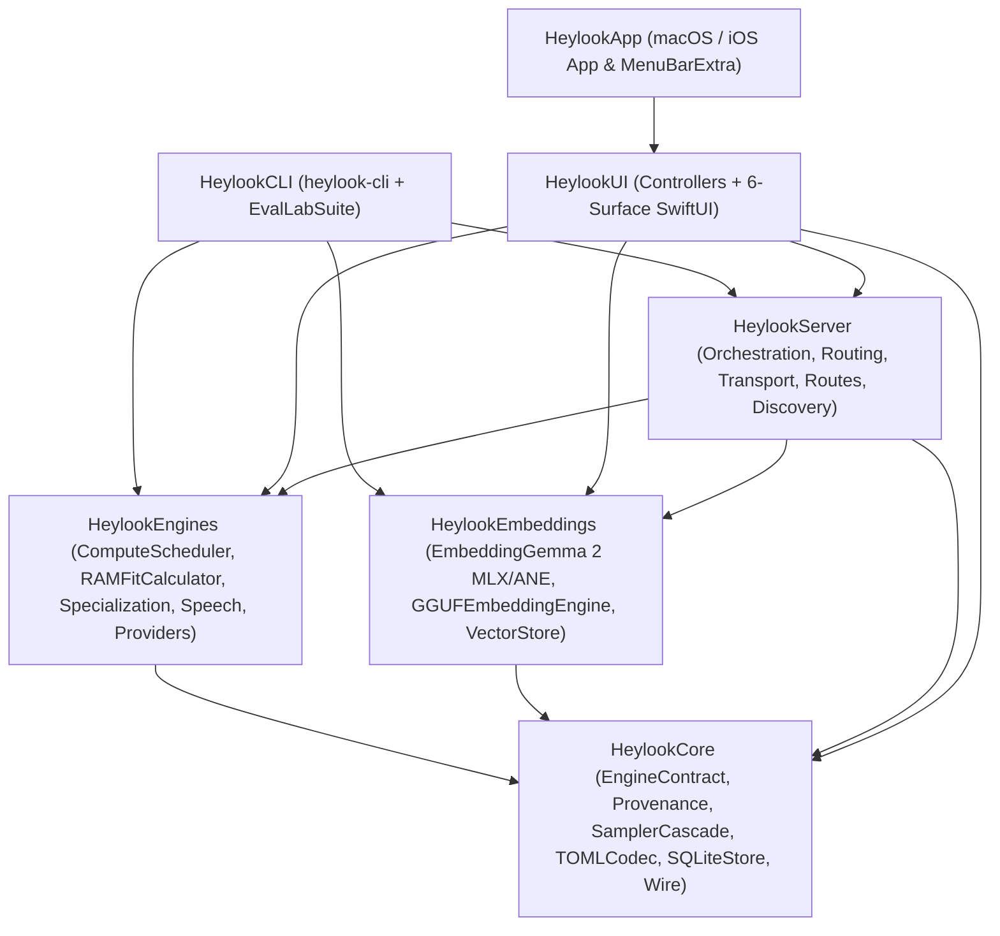

# 1. System Topology & Core Invariants

`heylookitsanllm-macos` (`heylook`) is a 100% native **Swift 6.4 (`v6` language mode)** multiplatform (`macOS 27.2+` and `iOS 27.2+` deployment floor, with `macOS 27.3` / `iOS 27.3` SDK features gated behind `#available(macOS 27.3, iOS 27.3, *)`) personal AI inference workbench, multimodal media/embedding studio, and embedded HTTP/SSE server built specifically for Apple Silicon unified memory and Apple Neural Engine (ANE) execution.

*(Package manifest metadata declares `swift-tools-version: 6.2` while compiling under the Swift 6.4 toolchain with strict `SwiftLanguageMode.v6` concurrency checking.)*

## 1.1 Module Graph & Directory Architecture

### Target Breakdown

- **`HeylookCore`** (`Sources/HeylookCore/`):
  - `Engine/`: `EngineDescription` / `ProvenanceField<T>` (internal model/capability metadata) and `EngineContract` / `Fact<Value>` / `SettingFact` / `PublicModelWireRow` / `AdminModelWireRow` / `EngineSanitization` (truthful wire contract).
  - `Config/`: `HeylookConfig` (root `heylook.toml` + per-model `model.heylook.toml`, 4+ rung chat template ladder, `GGUFHeaderReader`), `ProviderConfigSchema` (single declarative schema source of truth for `/v1/admin/model-options`, `PATCH` validation, `/reload`, and `EngineContract.settings`), `TOMLCodec` (comment-preserving TOML parser and surgical editor), `ModelTemplateInfo` (AST + `renderProbe` thinking & modality detection), and `HeylookJinjaRenderer` (embedded Jinja2 runtime + `checkPrefixStability`).
  - `Sampling/`: `SamplerCascade` (5-layer precedence cascade with canonical defaults `1.0 / 0.95 / 16384`).
  - `Parsing/`: `ReasoningParser` (4-protocol reasoning tag state machines + `forceEndReasoning()` + dynamic special-token filtering).
  - `Store/`: `SQLiteStore` (SQLite `WAL` mode storing `conversations`, `messages`, conversation-scoped 64-hex `media_blobs`, `message_stats`, `notebooks`, `presets`, and `mutationStream()`), and `ObservabilityDiskLog` (structured JSONL `events.jsonl` / `metrics.jsonl` rotation + in-memory ring `HeylookObservabilityLog`).
  - `Wire/`: `MessagesWire` (Anthropic `/v1/messages` + `HeylookProgressSSEEvent` + `HeylookSavedEvent` + `RequestRegistry` generation locks) and `WireDTOs` (`StrictSamplerParams`, conversation/notebook/preset/observability DTOs).
- **`HeylookEmbeddings`** (`Sources/HeylookEmbeddings/`):
  - `Domain/`: `Artifact` and `ArtifactSpan`.
  - `Engine/`: `EmbeddingEngine` (shared types, `EmbeddingTask`, `VideoWindowOptions`, `EmbeddingRequestLimits`, `Matryoshka`), `EmbeddingModelFacts` (`PromptCatalog` from `config_sentence_transformers.json`, MLX/CoreAI/GGUF fact derivation), `GGUFEmbeddingEngine` (`llama-server --embeddings`), `ModelComputeOptions` (`TowerComputeUnit`, `ComputePreset`, `ANETowerInspector`, `ANECoreMLRuntime`), and `NativeMLXEmbeddingGemma2` (`MLXSwiftLMEmbeddingGemma2Engine`, `HybridLocalEmbeddingEngine`, `CheckpointPieceTokenizer`).
  - `Pipeline/`: `ArtifactProcessor`, `WindowPlanner`, `FolderWatcher`, and `IndexCoordinator`.
  - `Store/`: `VectorStore` (`SQLite3` + `Accelerate`/`vDSP` cosine retrieval across `768d`/`512d`/`256d`/`128d` with truthful `model_id` invalidation).
- **`HeylookEngines`** (`Sources/HeylookEngines/`):
  - `ComputeScheduler.swift`: `InferenceProvider` protocol, `ComputeScheduler` (`GenerationGate`, `ANELane`, `withGPUEmbeddingLease`, live headroom eviction plan, `409 model_busy`), and `HardwareMemoryMonitor`.
  - `RAMFitCalculator.swift`: Mach + Metal + `sysctl iogpu.wired_limit_mb` fit evaluator (`thinHeadroomGB = 24.0`, hard fail on MLX vs warning on GGUF, layer-aware KV sizing).
  - `Specialization/ModelSpecialization.swift`: Signature-driven `CheckpointSignature`, `ModelSpecializationRegistry`, `Gemma4Specialization`, `HybridRecurrentSWASpecialization`, `StandardAttentionSpecialization`, and `InferenceProvider` contract extensions.
  - `Speech/SpeechTranscriptionService.swift`: Decoupled ANE ASR (`CoreAISpeech` + `SpeechAnalyzer`/`SpeechTranscriber`) with RIFF subchunk-safe PCM decoding.
  - `Providers/`: `StreamingPipeline`, `MLXRuntimeSupport` (`PreRenderedVLMTokenizerProxy`, `VisionFeatureCache`, `APCSnapshotCache`, `ThinkingControlLogitProcessor`, `LeviathanMTPTokenIterator`), `MLXSwiftProvider` (`MLXSwiftProvider`, `MLXModelConverter`), `CoreAIProvider`, `GGUFSubprocessProvider`, `RemoteHeylookProvider`, and `SubprocessSupport`.
- **`HeylookServer`** (`Sources/HeylookServer/`):
  - `HeylookHTTPServer.swift`: Embedded HTTP/SSE listener orchestrating lifecycle, Host DNS-rebinding defense, and optional `X-Heylook-Admin-Token` authentication.
  - `Orchestration/`: `WorkbenchBackend` protocol, `WorkbenchService` actor, `ConversationOrchestrator` saga, `RAMFitEvaluator`, and `TelemetryBuilder.swift` (`ChunkTelemetryAccumulator`).
  - `Transport/`: `HTTPConnectionHandler` (HTTP/1.1 Keep-Alive + chunked framing) and `SSEStreamWriter` (`5.0s` `event: ping`, `heylook_progress`, `performance`, `heylook_saved`).
  - `Routing/`: `PatternRouter` (greedy `*model_id` supporting `org/model` and `%2F`) and `ErrorMapping`.
  - `Routes/`: `MessagesAndAudioRoutes`, `ConversationsRoutes`, `ModelsAndAdminRoutes`, `NotebooksAndPresetsRoutes`, `EmbeddingsRoutes`, `MonitoringAndRequestsRoutes`, and `StaticFrontendRoutes` (optional `HEYLOOK_FRONTEND_DIR` serving).
  - `Discovery/`: `BonjourServiceBrowser` (`_heylook._tcp` LAN peer discovery).
- **`HeylookUI`** (`Sources/HeylookUI/`):
  - `HeylookWorkbenchViewModel.swift` (thin coordinator binding SQLite WAL mutations, `WorkbenchBackend`, and domain controllers).
  - `Controllers/`: `DocumentSettingsController`, `RemoteWorkbenchBackend`, `ChatController`, `NotebookAndPresetsController`, `EmbeddingsStudioController`, and `ModelsAndPerfController`.
  - `HeylookWorkbenchView.swift`: `HeylookRootView`, `AdaptiveContrastStyle`, layered `Escape`, `@Environment(\.scenePhase)` flush, and 6-surface navigation (`⌘1` Chat, `⌘2` Notebook, `⌘3` Presets, `⌘4` Embeddings & ANE, `⌘5` Models, `⌘6` Perf & Server).
  - `Surfaces/`: `ChatWorkbenchSurface`, `NotebookAndEmbeddingsSurfaces`, `PresetsSurface`, `ModelsAndSystemSurfaces`, `MarkdownMessageView`, and `CursorAwareTextEditor`.
- **`HeylookApp`** (`Sources/HeylookApp/`): Cross-platform app entry point (`macOS` + `iOS`) with macOS `MenuBarExtra` server/model lifecycle controller and `scenePhase` flush.
- **`HeylookCLI` (`heylook-cli`)** (`Sources/HeylookCLI/`): `HeylookCLI.swift` + `EvalLabSuite.swift` (`CLIEvalLabSuite` with zero synthetic fallback).

## 1.2 Core Architectural Invariants

1. **Remote SwiftPM Dependencies Only (`Package.swift`)**: External dependencies are always canonical remote GitHub packages behind optional environment gates (`HEYLOOK_ENABLE_NATIVE_MLX=1` for `mlx-swift`, `mlx-swift-lm`, `swift-transformers`; `HEYLOOK_ENABLE_COREAI=1` for `apple/coreai-models`). Linked Apple frameworks (`sqlite3`, `Accelerate`, `AVFoundation`, `CoreGraphics`, `CoreML`, `ImageIO`, `PDFKit`, `Metal`, `Speech`, `Network`, `SwiftUI`, `AVKit`, `UniformTypeIdentifiers`, plus `CoreServices` and `AppKit` on macOS) are declared directly in `Package.swift`.
2. **Truthful Runtime (Zero Silent Synthetic Fallbacks)**: Both `allowSyntheticFallback` and `DeterministicHashEmbeddingEngine` have been completely removed from production `Sources/`, along with legacy synthetic eval bridges and sample demo model fixtures. Unloaded or unconfigured capabilities throw structured errors (`ModelLoadError`, `EmbeddingValidationError`) or render `"value": null` (`Fact.unknown`).
3. **Derive, Don't Copy**: Sampler schema fields, UI controls, `PATCH`/`/reload` validators, thinking controls, vision patch alignment (`ModelSpecialization`), and sentence-transformer prompt tables are derived directly from canonical Swift definitions and model checkpoint files.
4. **Dual-Lane Silicon Scheduling + Single Orchestration Backend**: `ComputeScheduler` serializes GPU weight generation behind `GenerationGate` while allowing Neural Engine tasks (`ANELane`) to overlap cleanly. Above it, `WorkbenchService` (`WorkbenchBackend`) provides one canonical saga for both embedded HTTP routes and native `HeylookUI`.
5. **Solo Deployment / Clean SQLite WAL**: `SQLiteStore` and `VectorStore` run in `WAL` mode with idempotent `CREATE TABLE IF NOT EXISTS` or clean table recreation — no legacy schema migration scaffolding.
6. **Path Privacy**: Tracked files never contain personal home-directory paths, relative sibling workspace paths, or personal names; all defaults resolve dynamically via `FileManager.default.homeDirectoryForCurrentUser` / Application Support or environment variables (`HEYLOOK_CONFIG`, `HEYLOOK_STORE_DB_PATH`, `HEYLOOK_VECTOR_DB_PATH`, `HEYLOOK_DB_PATH`, `HEYLOOK_MODELS_DIR`, `HEYLOOK_READONLY_MODEL_CONFIG`, `HEYLOOK_FRONTEND_DIR`).
