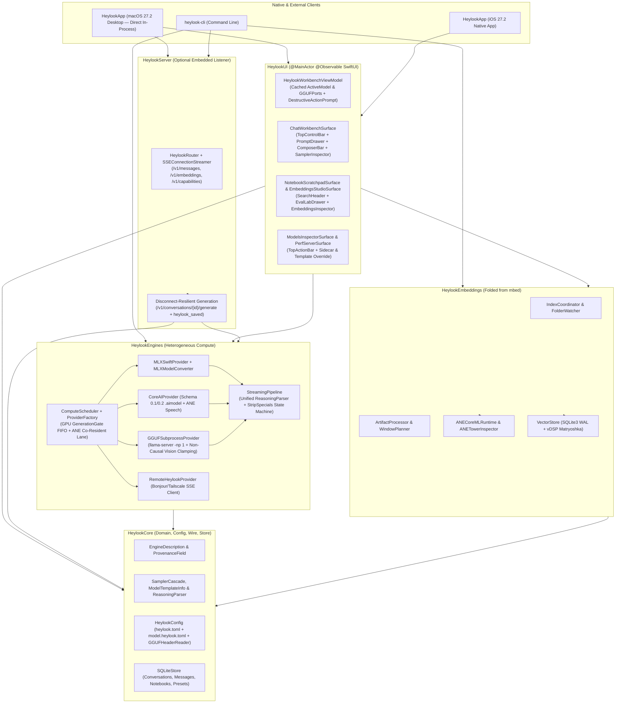

# Architecture Overview

`heylookitsanllm-macos` (`heylook`) is a multi-target Swift 6.2 package targeting **`macOS 27.2+`** and **`iOS 27.2+`**. It unifies the personal inference server and power-user workbench of `heylookitsanllm` with the native multimodal embedding and ANE/GPU tower-splitting architecture of `mbed`.

For deep-dive subsystem documentation, see the [LLM Knowledge Wiki Index](./README.md):
- [Engine Contract, Provenance & Sampler Cascade](./engine_contract_and_provenance.md)
- [Providers, Unified Streaming Pipeline & Heterogeneous Compute](./providers_and_heterogeneous_compute.md)
- [Multimodal Embeddings, ANE Towers & Matryoshka Store](./multimodal_embeddings_and_ane.md)
- [HTTP/SSE Wire API & SQLite Store](./wire_api_and_sqlite_store.md)
- [Model Family Onboarding & Porting Playbooks](./model_family_onboarding.md)
- [SwiftUI Architecture & macOS 27.2+ Design System](./ui_architecture_and_macos27.md)
- [Sharp Edges & Incident Rationales](./sharp_edges.md)

---

## 1. Execution Model: Direct In-Process Desktop vs. Optional Embedded Server

- **On macOS (`HeylookApp`)**: All 5 workbench surfaces (**Chat**, **Notebook**, **Embeddings & Media Studio**, **Models**, and **Perf**) invoke `ComputeScheduler`, `MLXSwiftProvider`, `CoreAIProvider`, `GGUFSubprocessProvider`, `IndexCoordinator`, and `SQLiteStore` **directly in-process in Swift memory**. No separate Python server or background HTTP daemon is required to use the desktop app.
- **Optional Embedded HTTP/SSE Listener (`HeylookHTTPServer`)**: Built directly into `HeylookApp` (as a Menu Bar / Perf tab toggle) and `heylook-cli serve`. Turning it on exposes the full `/v1/*` API (`POST /v1/messages`, `POST /v1/conversations/{id}/generate`, `POST /v1/embeddings`, `GET /v1/capabilities`, `GET /v1/models`) and advertises `_heylook._tcp` via Bonjour so the native **`iOS 27.2+` app** or external CLI scripts can drive the Mac Studio over LAN or Tailscale.

---

## 2. Core Invariants

1. **Truthful Runtime (Zero Silent Synthetic Fallbacks)**:
   - Production providers (`MLXSwiftProvider`, `CoreAIProvider`, `GGUFSubprocessProvider`, and `ProviderFactory`) default `allowSyntheticFallback = false` and fail loudly with `ProviderExecutionError` when weights or binaries are missing.
   - `DeterministicHashEmbeddingEngine` and `HybridLocalEmbeddingEngine` (when compiled `.mlmodelc` ANE towers are absent) report `modelID = "deterministic-hash-768d"`, never masquerading as `"embeddinggemma-2-MLX-BF16"` in `VectorStore.isUpToDate`.
2. **Visibility & Provenance (`EngineDescription`)**:
   - Every model setting is wrapped in `ProvenanceField<T>` recording `value`, `provenance` (`derived` | `configured` | `observed` | `observed_cached`), `effect` (`per_request` | `reload` | `restart`), and `computePlacement`.
3. **Heterogeneous GPU + ANE Co-Residency (`ComputeScheduler`)**:
   - **GPU Lane (`GenerationGate`)**: Serializes Metal GPU LLM/VLM generation with bounded FIFO queue depth (`max_queue_depth`), answering `503 model_overloaded` on overflow, and enforces GPU LRU eviction (`provider.unload()`).
   - **ANE Co-Resident Lane (`ANELane`)**: Runs ANE-assigned models and towers (`TowerComputeUnit.cpuAndNeuralEngine`) concurrently on the Apple Neural Engine without acquiring the GPU gate or evicting resident GPU models.
4. **Disconnect-Resilient Generation (`/v1/conversations/{id}/generate` & `/voice-generate`)**:
   - Persists the user turn to `SQLiteStore` before generation starts, runs the provider stream inside a server-owned `Task` registered in `RequestRegistry`, and persists the assistant message (`event: heylook_saved`) even if a mobile client drops its SSE connection mid-flight.
5. **Matryoshka Multimodal Vector Indexing (`HeylookEmbeddings`)**:
   - Stores full `768d` `Float32` embeddings once in SQLite (`WAL` mode) and slices/L2-normalizes to `768`, `512`, `256`, or `128` dimensions at query time via Apple `Accelerate` (`vDSP`), grouping search hits by parent `Artifact`.
6. **5-Layer Deterministic Sampler Cascade (`SamplerCascade`)**:
   - Resolves `builtin` -> `vendor generation_config.json` / GGUF `general.sampling.*` -> `model.heylook.toml` -> `preset` -> `request`, honored identically across HTTP routes and `HeylookWorkbenchViewModel`.
7. **Zero-Hardcoding Model Family Onboarding (`ModelTemplateInfo` & `StreamingPipeline`)**:
   - `ModelTemplateInfo` inspects checkpoint files directly on disk to derive `ReasoningFormat` (`.tagPair`, `.gemmaChannel`, `.harmonyChannel`, `.recipientChannel`, `.none`), `ThinkingControls` (`enable_thinking`, `reasoning_effort`, `reasoning_strength`), `strippableSpecialTokens`, and `eosTokenIDs`, feeding `StreamingPipeline.transformEventStream` across all providers without model-name branches.
