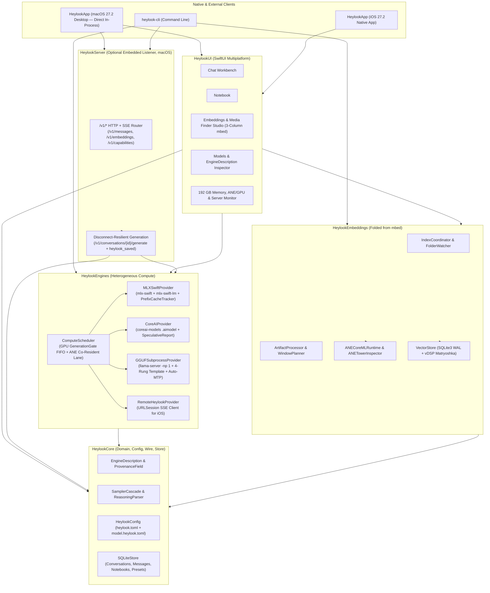

# Architecture Overview

`heylookitsanllm-macos` (`heylook`) is a multi-target Swift 6.2 package targeting **`macOS 27.2+`** and **`iOS 27.2+`**. It unifies the personal inference server and power-user workbench of `heylookitsanllm` with the native multimodal embedding and ANE/GPU tower-splitting architecture of `mbed`.

---

## 1. Execution Model: Direct In-Process Desktop vs. Optional Embedded Server

- **On macOS (`HeylookApp`)**: All 5 workbench surfaces (**Chat**, **Notebook**, **Embeddings & Media Studio**, **Models**, and **Perf**) invoke `ComputeScheduler`, `MLXSwiftProvider`, `CoreAIProvider`, `GGUFSubprocessProvider`, `IndexCoordinator`, and `SQLiteStore` **directly in-process in Swift memory**. No separate Python server or background HTTP daemon is required to use the desktop app.
- **Optional Embedded HTTP/SSE Listener (`HeylookHTTPServer`)**: Built directly into `HeylookApp` (as a Menu Bar / Perf tab toggle) and `heylook-cli serve`. Turning it on exposes the full `/v1/*` API (`POST /v1/messages`, `POST /v1/conversations/{id}/generate`, `POST /v1/embeddings`, `GET /v1/capabilities`, `GET /v1/models`) and advertises `_heylook._tcp` via Bonjour so the native **`iOS 27.2+` app** or external CLI scripts can drive the Mac Studio over LAN or Tailscale.

---

## 2. Core Invariants

1. **Visibility & Provenance (`EngineDescription`)**:
   Every loaded or registered model publishes an `EngineDescription` where each setting is wrapped in a `ProvenanceField<T>` recording:
   - `value`: effective value in force,
   - `provenance`: `derived` | `configured` | `observed` | `observed_cached` | `unknown` | `not_applicable`,
   - `effect`: `per_request` | `reload` | `restart`,
   - `computePlacement`: `mlx_gpu` | `ane` | `hybrid_ane_gpu` | `cpu_and_gpu` | `cpu_only` | `gguf_subprocess` | `remote`.
2. **Heterogeneous GPU + ANE Co-Residency (`ComputeScheduler`)**:
   - **GPU Lane (`GenerationGate`)**: Serializes Metal GPU LLM/VLM generation with bounded FIFO queue depth (`max_queue_depth`), answering `503 model_overloaded` on overflow.
   - **ANE Co-Resident Lane (`ANELane`)**: Runs ANE-assigned models and towers (`TowerComputeUnit.cpuAndNeuralEngine`) concurrently on the Apple Neural Engine without acquiring the GPU gate or evicting pinned GPU models.
3. **Disconnect-Resilient Generation (`/v1/conversations/{id}/generate`)**:
   - Persists the user turn to `SQLiteStore` before generation starts, runs the provider stream inside a server-owned `Task` registered in `RequestRegistry`, and persists the assistant message (including partial content + `thinking` + `stop_reason = "cancelled"` on abort) even if the mobile client drops its SSE connection mid-flight.
4. **Matryoshka Multimodal Vector Indexing (`HeylookEmbeddings`)**:
   - Stores full `768d` `Float32` embeddings once in SQLite (`WAL` mode) and projects/L2-normalizes to `768`, `512`, `256`, or `128` dimensions at query time via Apple `Accelerate` (`vDSP`), grouping search hits by parent `Artifact` so multi-window videos or multi-page PDFs never produce duplicate cards.
5. **5-Layer Deterministic Sampler Cascade (`SamplerCascade`)**:
   - Resolves `builtin` -> `vendor generation_config.json` -> `model.heylook.toml` -> `preset` -> `request`, recording per-field provenance (`derived`, `configured`, or `request`).
6. **4-Rung GGUF Template Ladder & Operator Overrides (`HeylookConfig` & `HeylookRouter`)**:
   - Resolves `chat_template_path` (sidecar override) > `chat_template.heylook.jinja` (operator override via `GET/PUT/DELETE /v1/admin/models/{id}/chat-template`) > `chat_template.jinja` (vendor ship) > `gguf_embedded` (`tokenizer.chat_template` in GGUF metadata), without ever mutating vendor files.
7. **Multimodal Capability Gating & Model-Derived Inspection (`/v1/messages`, `/image-plan`, `/prompt`)**:
   - Rejects image or audio attachments sent to text-only models with HTTP `422 invalid_request_error` naming the offending media type, computes pre-send image token budgets from `processor_config.json` / `config.json` (`vision_config`) via `POST /v1/models/{id}/image-plan` (`409` when unloaded, `200` when resident), and renders model-derived formatted prompts via `POST /v1/conversations/{id}/prompt`.
8. **Deterministic Memory & Subprocess Reclamation (`unload()` & `SubprocessLifecycleRegistry`)**:
   - Every `InferenceProvider` and `EmbeddingEngine` implements `unload() async`: `MLXSwiftProvider` releases `ModelContainer` + `cachedKVCaches` and calls `MLX.GPU.clearCache()`; `ANECoreMLRuntime` evicts loaded `MLModel` instances and unmaps `embed_tokens_fp16.bin`; and `GGUFSubprocessProvider` terminates its `llama-server` process via `SubprocessLifecycleRegistry` (`SIGTERM` -> `SIGKILL` + `atexit` hook). `ComputeScheduler` automatically calls `provider.unload()` on explicit unload, GPU LRU eviction, and `unloadAllModels()`.
9. **Incremental SSE Streaming (`SSEConnectionStreamer`) & Strict Execution Errors (`ProviderExecutionError`)**:
   - `HeylookHTTPServer` flushes each SSE frame (`message_start`, `content_block_delta`, `message_delta`, `message_stop`, `heylook_saved`) immediately over `NWConnection` as tokens are generated rather than buffering the entire stream in memory, and strict providers surface `ProviderExecutionError` (`checkpointNotFound`, `binaryNotFound`, `runtimeUnavailable`) rather than silently echoing synthetic tokens.
10. **Stateful Multi-Turn KV Slicing, GGUF Header Inspection, ANE Voice Handoff & `EvalLabSuite`**:
    - `PrefixCacheTracker` tracks exact token counts and branch-edit truncations (`branchTruncationsCount`) alongside `HeylookConfig.discoverDrafter` speculative drafter telemetry (`SpeculativeReport`).
    - `GGUFHeaderReader` parses GGUF v2/v3 binary KV headers (`general.architecture`, `<arch>.context_length`, `tokenizer.chat_template`, `clip.has_vision_encoder`, `clip.has_audio_encoder`, `general.sampling.*`, `*.ssm.*` hybrid-recurrent, and `*.nextn_predict_layers` built-in MTP), while `GGUFPortPool` assigns conflict-free loopback ports per `modelID` and `GGUFSubprocessProvider` queries `llama-server` `GET /props` on startup to upgrade `contextSize` and `templateSource` to `.observed` provenance.
    - `POST /v1/conversations/{id}/voice-generate` runs 16 kHz PCM + 128-bin HTK log-mel transcription on the ANE lane (`CoreAIProvider.transcribeAudio`), emits `event: heylook_voice_transcribed`, and streams the disconnect-resilient response (`event: heylook_saved`), verified alongside `EvalLabSuite` (`heylook-cli eval-lab`).
11. **Zero-Hardcoding Model Family Onboarding (`ModelTemplateInfo` & 4-Protocol `ReasoningParser`)**:
    - `ModelTemplateInfo` inspects `chat_template.jinja`, `tokenizer.json`, `tokenizer_config.json`, `generation_config.json`, `.aimodel/metadata.json` (`0.1` & `0.2`), and `.gguf` headers to derive each model's `ReasoningFormat` (`.tagPair`, `.gemmaChannel`, `.harmonyChannel`, `.recipientChannel`, `.none`), `ThinkingControls` (`supportsThinking`, `canDisableThinking`, `switchVariable`, `depthVariable`, `depthValues`), `strippableSpecialTokens`, and `eosTokenIDs`—feeding `MLXSwiftProvider` (`ModelConfiguration`), `CoreAIProvider`, `MessagesRequest` (`thinking_depth` / `reasoning_effort`), and `HeylookWorkbenchView` without per-model-family branches. See [Model Family Onboarding & Porting Playbook](./model_family_onboarding.md).
