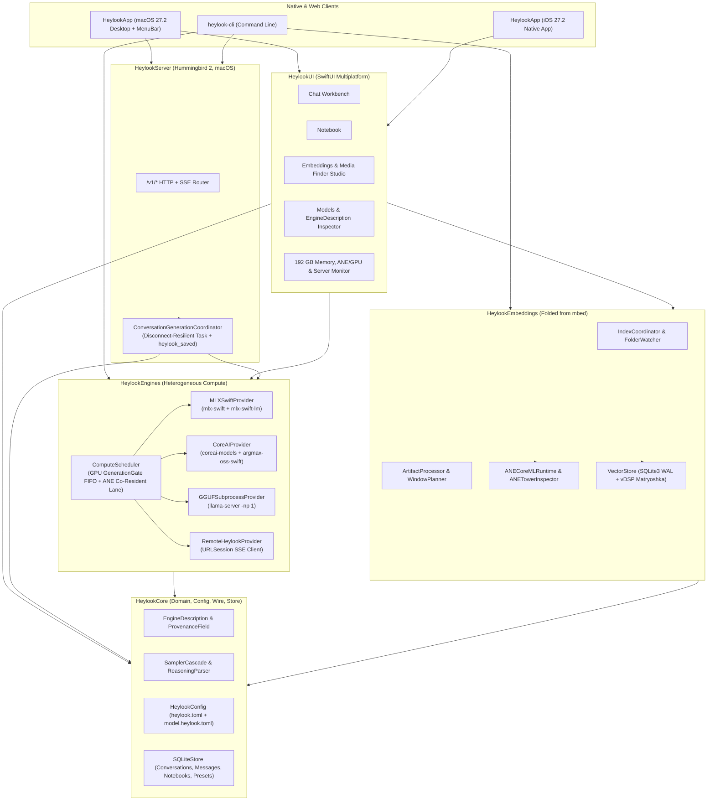

# Architecture Overview

`heylookitsanllm-macos` (`heylook`) is a multi-target Swift 6.2 package targeting **`macOS 27.2+`** and **`iOS 27.2+`**. It unifies the personal inference server and power-user workbench of `heylookitsanllm` with the native multimodal embedding and ANE/GPU tower-splitting architecture of `mbed`.

---

## 1. System Topology

---

## 2. Core Invariants

1. **Visibility & Provenance (`EngineDescription`)**:
   Every loaded or registered model publishes an `EngineDescription` where each setting is wrapped in a `ProvenanceField<T>` recording:
   - `value`: effective value in force,
   - `provenance`: `derived` | `configured` | `observed` | `observed_cached` | `unknown` | `not_applicable`,
   - `effect`: `per_request` | `reload` | `restart`,
   - `computeUnit`: `mlx_gpu` | `ane` | `cpu_and_gpu` | `cpu_only` | `gguf_subprocess` | `remote`.
2. **Heterogeneous GPU + ANE Co-Residency (`ComputeScheduler`)**:
   - **GPU Lane (`GenerationGate`)**: Serializes Metal GPU LLM/VLM generation with bounded FIFO queue depth (`max_queue_depth`), answering `503 model_overloaded` on overflow.
   - **ANE Co-Resident Lane (`ANELane`)**: Runs ANE-assigned models and towers (`TowerComputeUnit.cpuAndNeuralEngine`) concurrently on the Apple Neural Engine without acquiring the GPU gate or evicting pinned GPU models.
3. **Disconnect-Resilient Generation (`/v1/conversations/{id}/generate`)**:
   - Persists the user turn to `SQLiteStore` before generation starts, runs the provider stream inside a server-owned `Task` registered in `RequestRegistry`, and persists the assistant message (including partial content + `thinking` + `stop_reason = "cancelled"` on abort) even if the mobile client drops its SSE connection mid-flight.
4. **Matryoshka Multimodal Vector Indexing (`HeylookEmbeddings`)**:
   - Stores full `768d` `Float32` embeddings once in SQLite (`WAL` mode) and projects/L2-normalizes to `768`, `512`, `256`, or `128` dimensions at query time via Apple `Accelerate` (`vDSP`), grouping search hits by parent `Artifact` so multi-window videos or multi-page PDFs never produce duplicate cards.
